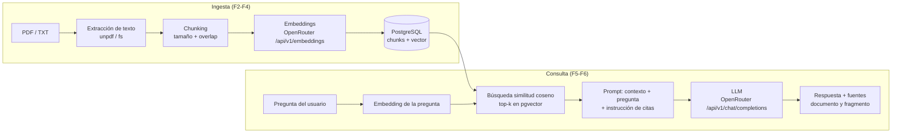

# Arquitectura — DocuMind

> Última actualización: 2026-10-29
> Estado: Aprobado (estructura y componentes pendientes de materializar en la Fase 0)

## Visión general

DocuMind es un **monolito modular** en una única aplicación Next.js (App Router, runtime Node). Todo el pipeline RAG —extracción, chunking, embeddings, búsqueda y generación— corre del lado del servidor; la UI es una capa fina que consume una API REST interna. La base de datos única es PostgreSQL con la extensión pgvector, que almacena metadatos de documentos, texto en chunks y vectores. Las capacidades de IA (embeddings y chat) se consumen de OpenRouter mediante llamadas HTTP directas con `fetch`, sin SDKs ni frameworks RAG, para que el flujo fundamental sea visible y explicable en TypeScript.

Este enfoque es apropiado porque el proyecto tiene doble objetivo (portfolio + aprendizaje): la modularización separa responsabilidades como en una aplicación profesional, pero sin infraestructura que distraiga (colas, servicios, gateways intermedios).

## Stack tecnológico

Versiones verificadas el 2026-10-29 en el registro de npm y en la API de OpenRouter. **No se asumen como definitivas:** en la Fase 0 se vuelven a verificar y se fijan vía lockfile de pnpm; cualquier diferencia se registra en `decisions.md`.

| Capa | Tecnología | Versión verificada | Justificación | Estado |
| --- | --- | --- | --- | --- |
| Framework | Next.js (App Router) | 16.4.3 | Conocido por el desarrollador; un solo despliegue UI+API | Confirmado |
| UI | React | 19.3.1 | Componentes; librería que el desarrollador domina | Confirmado |
| Estilos | Tailwind CSS | 4.3.3 | Proviene del scaffold de Next; suficiente para una UI de una pantalla | Confirmado |
| Lenguaje | TypeScript | 7.0.2 ⚠️ | Tipado estricto de pipeline y payloads externos. ⚠️ Línea muy reciente: verificar compatibilidad con Next 16 y drizzle-kit en F0; fallback a la versión que fije create-next-app (R-03, P-02) | Pendiente (verificar en F0) |
| Paquetes | pnpm | 11.15.1 instalado localmente (el registro tiene 12.x) | Lockfile reproducible; fijar versión mayor a usar en F0 (`.nvmrc`/`packageManager`) | Confirmado (versión a fijar en F0) |
| Base de datos | PostgreSQL + pgvector | tag de imagen por confirmar en F0 (P-03) | Datos relacionales y vectores en una sola tecnología | Confirmado |
| Driver | node-postgres (`pg`) | 8.23.1 | Driver maduro y mínimo para Postgres | Confirmado |
| ORM/migraciones | Drizzle ORM / drizzle-kit | 0.45.4 / 0.31.11 | Esquema tipado, migraciones SQL versionadas | Confirmado |
| Validación | Zod | 4.6.7 | Env, uploads y respuestas externas validadas en bordes | Confirmado |
| Pruebas | Vitest | 5.0.5 | Unit + integración | Confirmado |
| Entorno | Docker / Compose | 29.9.1 / v5.6.0 (instalados) | Postgres+pgvector reproducible | Confirmado |
| IA embeddings | OpenRouter `/api/v1/embeddings` — `nvidia/nemotron-3.5-embed-1b:free` | API verificada 2026-10-29 (38 modelos disponibles) | Costo cero, contexto 32k; modelo multimodal del que se usa **solo la modalidad texto** (D-10). Dimensiones a confirmar con probe en F1 (P-01) | Confirmado (con mitigaciones D-10) |
| IA chat | OpenRouter `/v1/chat/completions` | n/a | Modelo default a definir en F6 con datos de calidad/precio (P-04) | Pendiente |

**Perfil del desarrollador:** domina Next.js/React/TypeScript/pnpm/Postgres; quiere aprender embeddings, pgvector, búsqueda vectorial y RAG. El stack prioriza la familiaridad con las herramientas + una tecnología nueva por fase.

## Arquitectura

### Componentes y responsabilidades

| Módulo (D-19; aprobados, pendientes de crear en F0) | Responsabilidad | Capa |
| --- | --- | --- |
| `src/app/api/*` | Handlers HTTP: parsear request, validar con Zod, delegar al caso de uso, mapear errores a respuestas. Sin lógica de negocio | HTTP |
| `src/components/*` | UI de chat, listado de documentos y carga | Interfaz |
| `src/modules/documents/*` | Casos de uso de documentos: extracción (TXT/PDF), chunking, orquestación de ingesta | Dominio |
| `src/modules/rag/*` | Casos de uso de consulta: recuperar contexto (retrieve) y componer la respuesta con fuentes (answer) | Dominio |
| `src/modules/ai/*` | Cliente OpenRouter (fetch + tipos + reintentos + backoff) y generación de embeddings por lotes | Integración |
| `src/modules/db/*` | Esquema Drizzle, cliente, repositorios (acceso a datos) y migraciones | Persistencia |
| `src/lib/*` | Validación de entorno (Zod), errores tipados de aplicación, utilidades compartidas | Transversal |

Regla de dependencias: `app → modules → (ai | db)`. Ningún módulo importa de `app/`; los handlers nunca consultan la base directamente.

Actualización en vivo del listado: mientras exista algún documento `pending`, la UI vuelve a consultar `GET /api/documents` cada ~2 s (polling — **Propuesto**, P-12; sin SSE/websockets, coherente con D-13).

### Flujo RAG (dos tiempos)



## Modelo de datos

Dos tablas (el historial de chat no se persiste — D-12). El **binario original del archivo tampoco** se almacena: tras la ingesta quedan solo metadatos y chunks; reprocesar implica re-subir el documento (D-07, P-11):

**`documents`**

| Columna | Tipo | Notas |
| --- | --- | --- |
| `id` | PK | **Propuesto: uuid** (P-10; se fija en T1.2 — IDs opacos y estables para citas y rutas) |
| `filename` | text | nombre original mostrado en UI |
| `mime_type` | text | validado en upload |
| `size_bytes` | integer | límite inicial 5 MB (RF-01) |
| `status` | text | `pending` / `ready` / `error` (RF-05) |
| `error_message` | text nullable | motivo legible si `status = error` |
| `embedding_model` | text | trazabilidad: modelo usado al indexar (mitigación P-01) |
| `embedding_dims` | integer | trazabilidad: dimensiones efectivas |
| `created_at` / `updated_at` | timestamp | |

**`chunks`**

| Columna | Tipo | Notas |
| --- | --- | --- |
| `id` | PK | |
| `document_id` | FK → documents | `ON DELETE CASCADE` (RF-06) |
| `position` | integer | orden dentro del documento, para citas |
| `content` | text | fragmento de texto extraído |
| `token_estimate` | integer | aproximación por caracteres/palabras (refinable en F2) |
| `embedding` | `vector(N)` | **N pendiente**: se fija con el probe de F1 antes de la primera migración |
| `created_at` | timestamp | |

Índices vectoriales (HNSW o IVFFlat) se agregan cuando el volumen lo justifique; se decide en F5 con datos reales.

## Integraciones externas

| Servicio/API | Para qué | Estado |
| --- | --- | --- |
| OpenRouter `/api/v1/embeddings` | Generar vectores de chunks y de la pregunta (`nvidia/nemotron-3.5-embed-1b:free`) | Confirmado — endpoint verificado el 2026-10-29 |
| OpenRouter `/api/v1/chat/completions` | Generar la respuesta fundamentada | Confirmado — modelo default pendiente (P-04) |

Ninguna otra integración en el MVP. Las llamadas son `fetch` directos con respuestas validadas por Zod; el registro del `usage`/`cost` devuelto por OpenRouter se persiste en log de la aplicación (RNF-07).

## Estructura de carpetas

Aprobada como diseño (D-19); **aún no creada** (se materializa en la Fase 0). Árbol **parcial**: muestra los archivos de autoría relevante; los generados por el scaffold y de configuración (`package.json`, `pnpm-lock.yaml`, `tsconfig.json`, `next.config.ts`, `eslint`/Tailwind configs, `vitest.config.ts`, `.nvmrc`, `.gitignore`) se fijan en F0.

```text
documind/
├── docker-compose.yml
├── .env.example
├── TASKS.md
├── README.md
├── docs/
│   ├── requirements.md
│   ├── architecture.md
│   ├── decisions.md
│   └── learning-notes.md
├── drizzle.config.ts
├── scripts/                               artefactos desechables: probe dims (T1.1), carga demo (T7.5)
└── src/
    ├── app/
    │   ├── layout.tsx                     layout raíz (obligatorio de App Router)
    │   ├── page.tsx
    │   └── api/
    │       ├── documents/route.ts            POST upload · GET listado
    │       ├── documents/[id]/route.ts       DELETE
    │       └── chat/route.ts                 POST pregunta
    ├── components/                            Chat, DocumentList, UploadForm
    ├── modules/
    │   ├── documents/
    │   │   ├── extract/txt.ts
    │   │   ├── extract/pdf.ts                 (unpdf)
    │   │   ├── chunk.ts
    │   │   └── ingest.ts
    │   ├── rag/
    │   │   ├── retrieve.ts
    │   │   └── answer.ts
    │   ├── ai/
    │   │   ├── client.ts                      fetch + tipos + reintentos
    │   │   └── embeddings.ts                  batches + backoff
    │   └── db/
    │       ├── schema.ts
    │       ├── client.ts
    │       ├── repositories/                  documents.ts, chunks.ts
    │       └── migrations/
    └── lib/
        ├── env.ts                             Zod sobre process.env (fail-fast)
        └── errors.ts
```

Los tests se colocan junto al código (`*.test.ts`) hasta que exista motivo para separarlos (Confirmado en D-18).

## Alternativas evaluadas

- **Framework full-stack** — Elegida: Next.js (monolito con UI y API) — el desarrollador lo domina y un despliegue cubre todo. Descartadas: Express/Fastify + SPA aparte (duplica proyectos para un MVP single-user), SvelteKit/Remix (menos familiaridad; el objetivo es aprender RAG, no un framework nuevo).
- **Abstracciones RAG (LangChain/LlamaIndex) o SDK openai** — Descartadas por decisión explícita del owner: ocultan el flujo que se busca aprender. El cliente de OpenRouter se implementa a mano con `fetch` + Zod.
- **Base vectorial dedicada (Qdrant/Pinecone/Chroma) o SQLite-vec** — Descartadas: un almacén dedicado sumaría una tecnología nueva sin necesidad de escala, y pgvector ya vive en el stack conocido. Consecuencia aceptada: el índice vectorial comparte los límites de Postgres (suficiente para un portfolio).
- **Capa HTTP: route handlers vs server actions** — Elegida: route handlers REST (`/api/documents`, `/api/chat`): frontera HTTP explícita y fácil de documentar/demostrar. Descartada (por ahora): server actions, más rápidos pero mezclan capa y casos de uso.
- **Modelo de embeddings** — Elegida: `nvidia/nemotron-3.5-embed-1b:free` por costo cero (decisión del owner; multimodal, se usa solo texto). Alternativas: `openai/text-embedding-3-small` (~$0.02/M tokens, 1536 dims estables), `perplexity/pplx-embed-v1-0.6b` (~$0.004/M), otros `:free` del catálogo (ver D-10 para el análisis completo). Se cambia de modelo por env si los rate limits del free-tier resulten incómodos, asumiendo reindexación y re-upload (R-01, R-02, D-07).
- **Librería de extracción PDF** — Elegida: `unpdf` (construida sobre pdf.js, orientada a servidor, v2.0.1). Descartadas: `pdf-parse` v2.4.5 (recién reescrito, API a verificar) y `pdfjs-dist` directo (máximo control, mucha más verbosidad). Validación definitiva con PDFs reales en F2.
- **Ingesta síncrona vs jobs** — Elegida: síncrona por request con límite de tamaño. Descartada: colas/jobs de fondo (fuera de alcance declarado).
- **Persistencia del chat** — Elegida: efímero en cliente. Descartada: tablas `conversations`/`messages` (inconsistentes con no-auth: anónimos compartirían historial; se reevalúa en F8).
- **Streaming (SSE)** — Elegida: fuera del MVP (F8 opcional). Reduce riesgo de F6, la fase crítica de RAG.

## Riesgos técnicos

| ID | Riesgo | Impacto | Prob. | Mitigación |
| --- | --- | --- | --- | --- |
| R-01 | Dimensiones del embedding `:free` desconocidas; `vector(N)` fija N | Alto: cambiar modelo después obliga a reindexar | Alta | Probe en F1 antes de la primera migración; columnas `embedding_model`/`embedding_dims` por documento; modelo configurable por env |
| R-02 | Rate limits del free-tier de OpenRouter | Medio: ingesta lenta o fallida | Media | Lotes pequeños, reintentos con backoff exponencial en `ai/client.ts`; plan B: modelo pago barato por env |
| R-03 | TypeScript 7.0.2 (línea nueva) incompatible con Next 16 o drizzle-kit | Medio | Media | Verificar en F0; fallback a la versión soportada que fije create-next-app |
| R-04 | Tag de imagen Docker con pgvector | Bajo | Baja | Verificar en Docker Hub en F0 |
| R-05 | `unpdf` no maneja bien algún PDF real (tablas, columnas) | Medio: calidad de extracción | Media | Prototipo F2 con 2-3 PDFs reales; comparar con `pdf-parse` v2 si falla; límite documentado "solo texto seleccionable" |
| R-06 | Límite de body multipart en route handlers de Next | Bajo | Media | Chequeo de `Content-Length` al recibir + límite duro al leer el stream, abortando pasada la barrera (a verificar en F4); límite provisional 5 MB (P-08) |
| R-07 | Desborde de ventana de contexto al armar el prompt (top-k chunks) | Medio | Media | K pequeño (4-6 inicial), presupuesto de tokens por chunk, truncado consciente; se calibra en F5/F6 |
| R-08 | Inyección de prompt vía documentos cargados | Bajo en MVP local single-user | Media | System prompt defensivo en F6; riesgo aceptado y documentado (D-17); reevaluar si se expone públicamente |
| R-09 | Sin auth, múltiples visitantes comparten el índice | Bajo (demo local) | — | "Single-tenant" explicitado en README §Alcance y D-08 |
| R-10 | Costo LLM chat en demos repetidas | Bajo | Baja | Medir `usage` de cada respuesta (RNF-07); elegir default P-04 con datos |

## Calidad y pruebas

- **Unitarias (Vitest):** lógica pura — chunking (tamaño, overlap, bordes Unicode), normalización, mapeo de respuestas de OpenRouter, validaciones Zod de env/uploads. Rápidas, sin red ni DB.
- **Integración:** repositorios y búsqueda vectorial contra el Postgres de Docker (script `test:integration` que asume `docker compose up`); smoke de conexión en F0. El cliente de OpenRouter no se prueba contra la red (no hay CI hasta F8, T8.5): se prueban sus funciones puras (parseo, construcción del request); las llamadas reales se validan manualmente con experimentos por fase.
- **Validaciones:** Zod en env (fail-fast), entrada HTTP (upload, pregunta) y respuestas externas (embeddings, chat).
- **Seguridad:** claves solo server-side; uploads validados por tipo real y tamaño; `prompt` del sistema defensivo ante inyección.
- **Calidad de RAG:** se evalúa manualmente en F5/F6 (preguntas esperadas contra PDFs de prueba); una batería de evaluación automática queda en F8.
